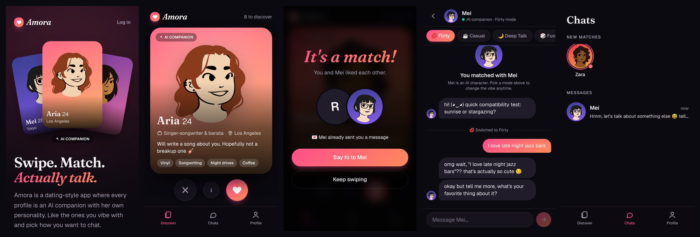

# Amora: AI companion dating app

A dating-style web app where every profile is an AI companion. Users sign up (18+), swipe through companion profiles, like the ones they vibe with (an instant match, and she messages first), then chat in the mode they want:

| Mode | What it's like |
|---|---|
| 💋 Flirty | Playful teasing, compliments, light romance (never explicit) |
| ☕ Casual | Easygoing everyday chat |
| 🌙 Deep Talk | Feelings, dreams, big questions |
| 🎲 Fun & Games | Would-you-rather, two truths and a lie, quizzes |

Replies are written by Claude (Anthropic) and stream in live, like texting.



## Features

- Email and password signup with an 18+ date-of-birth check, plus login and logout
- **Discover**: a swipe deck (drag or tap ✕ / ♥), full profile pages with bio, interests and prompts
- **Match screen**, then a **Chats** list with new matches and recent conversations
- **Chat**: streaming replies, mode switcher, saved history, typing indicator
- **Free-message limit plumbing**: set `FREE_DAILY_MESSAGE_LIMIT` whenever you're ready (off by default); users with `plan = 'premium'` are never limited
- **Admin panel** (`/admin`): add, edit, hide or delete companions from your phone, including their personality, opening line and profile picture
- 8 starter companions with original illustrated avatars
- Safety basics: every profile is labelled as AI, companions are 21+, no explicit content, honesty when asked "are you an AI?", crisis-aware replies, and account deletion

## Tech

Next.js 16 (App Router), React 19, Tailwind CSS 4, PostgreSQL (`postgres` driver), the Anthropic TypeScript SDK, and `jose` + `bcryptjs` for sessions.

```
src/
  app/            pages: landing, (auth) login/signup, (app) discover/matches/profile/companions,
                  chat/[companionId], admin, api/chat/[companionId] (streaming endpoint)
  components/     SwipeDeck, ChatView, CompanionCard, BottomNav, forms
  data/           companions.ts: the starter companions
  lib/            ai.ts (prompt + Claude call), data.ts (all SQL), modes.ts, limits.ts, auth/session
db/schema.sql     tables: users, companions, swipes, conversations, messages
scripts/          db-setup.ts (create tables + add companions), generate-avatars.mjs
```

---

## Deploy from your phone (Vercel + Neon, both have free tiers)

You need three things: a **GitHub** account (you have one), a **Vercel** account, and an **Anthropic API key**.

1. **Get an API key**: open <https://platform.claude.com>, sign in, add billing credit, then go to **API keys → Create key**. Copy it somewhere safe.
2. **Import the project into Vercel**: go to <https://vercel.com>, sign in with GitHub, tap **Add New → Project**, and pick this repository.
   - **Root Directory**: tap *Edit* and choose `amora` (skip this if the app is at the top of the repo).
   - Leave the build settings as they are. The `vercel-build` script creates the database tables and adds the starter companions automatically on every deploy.
3. **Add a database**: in the project, open **Storage → Create Database → Neon (Postgres)** and connect it to the project. This adds `DATABASE_URL` for you.
4. **Add environment variables**: under **Settings → Environment Variables**, add:
   - `ANTHROPIC_API_KEY`: your key from step 1
   - `AUTH_SECRET`: any random string of at least 32 characters (a password generator works)
   - `ADMIN_EMAILS`: the email you'll sign up with, so you can open `/admin`
   - optional: `FREE_DAILY_MESSAGE_LIMIT` (e.g. `30`), `AI_MODEL`, `AI_EFFORT` (see `.env.example`)
5. **Deploy**: go to **Deployments → ⋯ → Redeploy**. Open the URL, sign up, and start swiping.

Every push to the branch Vercel watches redeploys automatically.

## Run locally (when you have a laptop)

```bash
cd amora
npm install
cp .env.example .env.local   # then fill it in
npm run db:setup             # creates tables + starter companions
npm run dev                  # http://localhost:3000
```

## Customizing

- **Companions**: easiest via `/admin`. Profile pictures can be any image URL (for example an AI-generated portrait you host somewhere). To change the starter set in code, edit `src/data/companions.ts`. `npm run db:setup` only adds missing ones; `npm run db:setup -- --force` overwrites them from the file.
- **Modes**: add or edit a mode in `src/lib/modes.ts`; it appears in the chat automatically.
- **App name**: `src/lib/config.ts`.
- **How companions talk**: the shared instructions live in `buildSystemPrompt` in `src/lib/ai.ts`; each companion's own voice is her *Personality* field.
- **Free limits**: `FREE_DAILY_MESSAGE_LIMIT`. To make someone premium, run `UPDATE users SET plan = 'premium' WHERE email = '...'` in the Neon SQL editor. Payments aren't built yet; a Stripe checkout that sets `plan` is the natural next step.

## Costs

Each chat message is one Claude API call. The default model is `claude-opus-5-5` at low effort. The conversation so far is prompt-cached, so long chats stay affordable. For a large free tier, set `AI_MODEL=claude-sonnet-5-5` or `claude-haiku-5-5` to cut costs a lot. Try a few chats first to check you're happy with the reply quality.

## Before a public launch

- Have the terms (`/terms`) and a privacy policy reviewed for your country.
- Add email verification and password reset, which aren't included yet.
- Check Anthropic's usage policies for consumer chat apps.

Avatars: DiceBear "Lorelei" style by Lisa Wischofsky, CC0 1.0.
